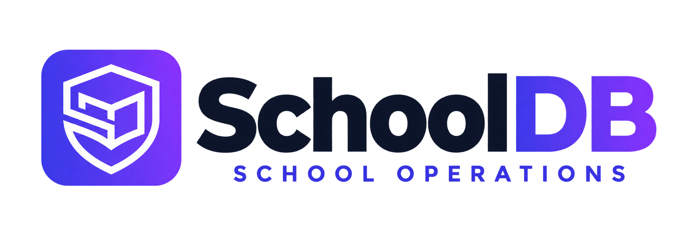
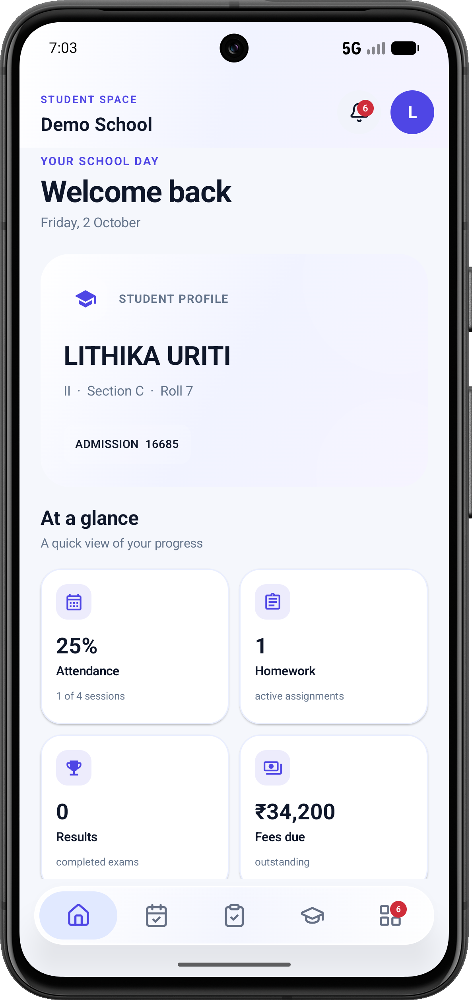
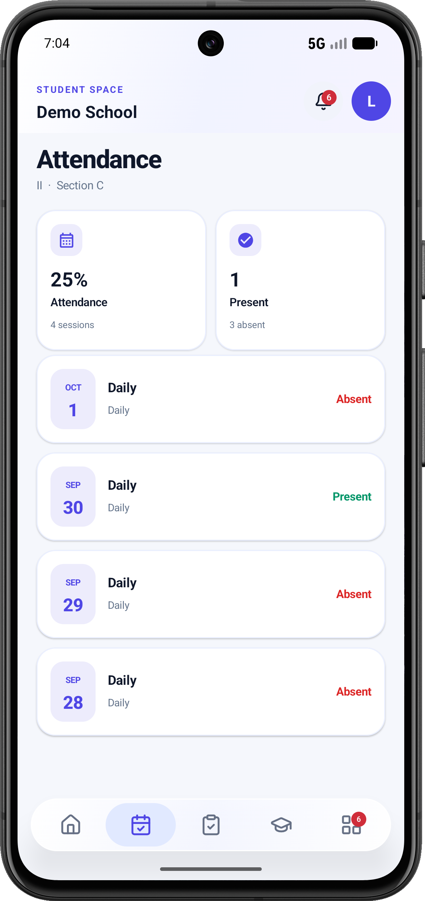
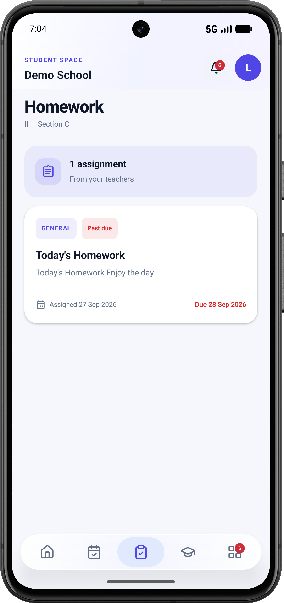
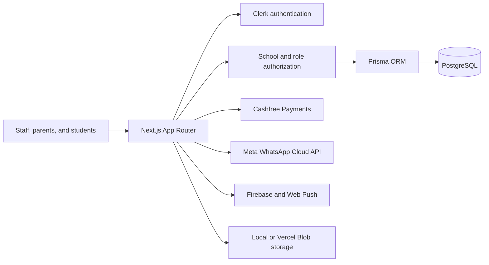

<p align="center">
  
</p>

<h1 align="center">Modern school operations, in one secure workspace.</h1>

<p align="center">
  SchoolDB is a multi-tenant school management platform for academics, attendance,
  fees, communication, and parent/student self-service.
</p>

<p align="center">
  <a href="#product-tour">Product tour</a> ·
  <a href="#platform-modules">Modules</a> ·
  <a href="#quick-start">Quick start</a> ·
  <a href="#role-based-user-guides">User guides</a>
</p>

<p align="center">
  
  
  
  
  
  
</p>

> [!IMPORTANT]
> SchoolDB is private, proprietary software. Access, use, redistribution, and
> deployment require explicit authorization from the repository owner.

## Why SchoolDB

<table>
  <tr>
    <td width="33%" align="center">
      <strong>One operational source</strong><br />
      <sub>Students, staff, academics, attendance, fees, and communication stay connected.</sub>
    </td>
    <td width="33%" align="center">
      <strong>Built for every role</strong><br />
      <sub>Focused workflows for administrators, teachers, finance teams, parents, and students.</sub>
    </td>
    <td width="33%" align="center">
      <strong>Tenant-safe by design</strong><br />
      <sub>Every school-scoped record is protected by membership and role-aware authorization.</sub>
    </td>
  </tr>
</table>

## Product tour

The self-service experience is designed for quick, mobile-first access to the
information families use most.

<table>
  <tr>
    <td width="33%"></td>
    <td width="33%"></td>
    <td width="33%"></td>
  </tr>
  <tr>
    <td align="center"><strong>Overview</strong><br /><sub>One glance at the school day</sub></td>
    <td align="center"><strong>Attendance</strong><br /><sub>Clear status and history</sub></td>
    <td align="center"><strong>Homework</strong><br /><sub>Assignments organized by subject</sub></td>
  </tr>
</table>

> [!NOTE]
> Screenshots use anonymized demo data. Do not commit real student, parent,
> staff, payment, or contact information.

## Platform modules

| Area | What it covers |
| --- | --- |
| **Admissions & students** | Enquiries, admissions, student records, guardians, documents, promotions, and transfers |
| **Academics** | Academic years, classes, sections, subjects, timetables, homework, examinations, marks, and report cards |
| **Attendance** | Daily and subject attendance, staff attendance, leave workflows, and operational reporting |
| **Fees & finance** | Fee structures, invoices, discounts, collections, receipts, refunds, reminders, and reconciliation |
| **People & access** | Staff directories, role-based membership, onboarding, invitations, and user lifecycle management |
| **Communication** | Notices, push notifications, WhatsApp messaging, alerts, and delivery tracking |
| **Transport & operations** | Routes, stops, vehicles, drivers, assignments, and operational records |
| **Self-service** | Dedicated parent and student experiences for attendance, homework, notices, fees, and receipts |

### Role-based journeys

| Role | Primary experience |
| --- | --- |
| **Super Admin** | Create and manage schools, platform access, and high-level operations |
| **School Admin** | Configure the school, academic structure, staff, permissions, and day-to-day workflows |
| **Teacher** | Manage class attendance, homework, marks, and student-facing academic activity |
| **Accountant** | Configure fees, collect payments, issue receipts, reconcile transactions, and report balances |
| **Receptionist** | Handle enquiries, visitor-facing tasks, student lookup, and supported fee collection |
| **Parent** | View linked children, attendance, homework, notices, fees, and receipts |
| **Student** | View personal academics, attendance, homework, notices, and fee information |

## Architecture



Every school-scoped request follows the same boundary:

```text
Authenticated identity → school membership → role permission → tenant-scoped data
```

This rule applies to pages, route handlers, server actions, exports, background
jobs, payment callbacks, and messaging workflows.

## Technology

| Layer | Technology |
| --- | --- |
| Application | Next.js 16 App Router, React 19, TypeScript |
| Styling | Tailwind CSS 4, Radix UI, Lucide icons |
| Authentication | Clerk |
| Data | PostgreSQL, Prisma ORM 7 |
| Payments | Cashfree Payments |
| Messaging | Meta WhatsApp Cloud API |
| Notifications | Firebase Admin, Firebase Cloud Messaging, Web Push |
| Storage | Local development storage or Vercel Blob |
| Quality | Node.js test runner, Playwright, TypeScript, ESLint |

## Quick start

### Prerequisites

- Node.js 20 or newer
- npm
- PostgreSQL
- A Clerk application
- Optional integration credentials for Cashfree, Meta WhatsApp, Firebase, and
  Vercel Blob

### 1. Install the project

```bash
git clone <your-authorized-repository-url>
cd schooldb
npm ci
```

### 2. Create the local environment

```bash
cp .env.example .env.local
```

Configure these minimum values in `.env.local`:

```dotenv
DATABASE_URL="postgresql://..."
DIRECT_DATABASE_URL="postgresql://..."
NEXT_PUBLIC_CLERK_PUBLISHABLE_KEY="pk_..."
CLERK_SECRET_KEY="sk_..."
SCHOOLDB_BOOTSTRAP_SECRET="replace-with-a-long-random-secret"
```

Generate a strong bootstrap secret locally with:

```bash
openssl rand -hex 32
```

`SCHOOLDB_BOOTSTRAP_SECRET` is a one-time owner secret—not a Clerk password. It
protects creation of the first `SUPER_ADMIN` and first school. Keep it private
and never commit it.

### 3. Prepare the database

```bash
npx prisma generate
npx prisma migrate dev
```

### 4. Start SchoolDB

```bash
npm run dev
```

Open [http://localhost:3000](http://localhost:3000).

### 5. Complete first-time onboarding

1. Open `/onboarding`.
2. Sign in with Clerk, or create a Clerk account if you do not have one.
3. Enter the school name, URL slug, and the exact value of
   `SCHOOLDB_BOOTSTRAP_SECRET`.
4. Create the workspace.
5. Continue through the school setup checklist.

Onboarding is intentionally available only while no active `SUPER_ADMIN`
exists. After initial setup, sign in normally and create additional schools from
**Schools → Add School**; do not reuse the onboarding page.

## Environment configuration

Use `.env.example` as the source of truth. The main groups are:

| Group | Variables |
| --- | --- |
| Database | `DATABASE_URL`, `DIRECT_DATABASE_URL` |
| Authentication | `NEXT_PUBLIC_CLERK_PUBLISHABLE_KEY`, `CLERK_SECRET_KEY` |
| Bootstrap | `SCHOOLDB_BOOTSTRAP_SECRET` |
| Payments | `CASHFREE_APP_ID`, `CASHFREE_SECRET_KEY`, `CASHFREE_ENV` |
| WhatsApp | `META_PHONE_NUMBER_ID`, `META_WA_TOKEN`, `META_APP_SECRET`, `META_WABA_ID` |
| Email OTP | `RESEND_API_KEY`, `AUTH_EMAIL_FROM` |
| Push | `FIREBASE_PROJECT_ID`, `FIREBASE_CLIENT_EMAIL`, `FIREBASE_PRIVATE_KEY`, VAPID keys |
| Storage | `SCHOOLDB_PRIVATE_STORAGE_DIR`, `BLOB_READ_WRITE_TOKEN` |
| End-to-end tests | `E2E_BASE_URL`, `E2E_SCHOOL_SLUG`, `E2E_AUTH_STATE` |

> [!CAUTION]
> Never commit `.env.local`, API tokens, service-account JSON, payment secrets,
> or production database credentials.

## Integrations

<details>
<summary><strong>WhatsApp Cloud API</strong></summary>

SchoolDB supports payment confirmations, fee reminders, receipts, admission
updates, homework alerts, notices, and attendance notifications.

Create and approve the required templates in Meta WhatsApp Manager. The
repository also includes helpers for selected operational templates:

```bash
node scripts/create-attendance-correction-whatsapp-template.mjs
node scripts/create-staff-attendance-whatsapp-template.mjs
node scripts/create-support-assignment-whatsapp-template.mjs
```

Template names, language, API version, automation, and webhook verification are
configured with the `META_WA_*` variables documented in `.env.example`.

</details>

<details>
<summary><strong>Cashfree Payments</strong></summary>

```dotenv
CASHFREE_ENV="sandbox"
CASHFREE_APP_ID="..."
CASHFREE_SECRET_KEY="..."
```

- Create orders only from authenticated, authorized server-side flows.
- Verify payment state server-side before marking an invoice paid.
- Configure Cashfree callbacks to reach the deployed webhook endpoint.
- Use HTTPS and rotate secrets before production launch.

</details>

<details>
<summary><strong>Push notifications</strong></summary>

Firebase Admin powers server-side delivery, while FCM and Web Push support
client notifications. Configure the Firebase project credentials and VAPID keys
listed in `.env.example` before enabling notification workflows.

</details>

<details>
<summary><strong>File storage</strong></summary>

Use `SCHOOLDB_PRIVATE_STORAGE_DIR` for local development. When
`BLOB_READ_WRITE_TOKEN` is configured, SchoolDB uses private Vercel Blob storage
for supported production document and export workflows.

</details>

## Commands

| Command | Purpose |
| --- | --- |
| `npm run dev` | Start the development server |
| `npm run build` | Create a production build |
| `npm run start` | Run the production server |
| `npm run lint` | Run ESLint |
| `npm run typecheck` | Run TypeScript checks |
| `npm run test` | Run the Node.js test suite |
| `npm run test:e2e` | Run the authenticated Playwright suite |
| `npm run test:e2e:public` | Run public-page Playwright tests |
| `npm run validate` | Validate the Prisma schema |
| `npm run load:test` | Run the configured API load test |
| `npm run web-push:keys` | Generate Web Push VAPID keys |
| `npm run db:migrate:deploy` | Apply production database migrations |

## Testing

Run the local quality gate:

```bash
npm run lint
npm run typecheck
npm run test
npm run build
```

For authenticated Playwright tests, create a saved browser state with Playwright
after signing in to a dedicated non-production account, then configure:

```dotenv
E2E_BASE_URL="http://localhost:3000"
E2E_SCHOOL_SLUG="your-test-school"
E2E_AUTH_STATE="playwright/.auth/admin.json"
```

Then run:

```bash
npm run test:e2e
```

Regenerate an expired saved session with an email OTP:

```bash
E2E_LOGIN_EMAIL="your-test-account@example.com" npm run test:e2e:auth
```

Use a dedicated non-production test account and rotate it regularly.

## Security and tenancy

- Keep all school data queries scoped by `schoolId` or an equivalent tenant key.
- Verify active membership before allowing access to school-scoped resources.
- Enforce permissions on the server; client-side visibility is not authorization.
- Never accept a tenant identifier from the browser without validating access.
- Keep credentials and personal data out of source control, logs, screenshots,
  and test fixtures.
- Validate all payment and webhook events server-side.

## Role-based user guides

The in-app guide is available at:

```text
/{schoolSlug}/user-guide
/{schoolSlug}/my/guide
```

Repository documentation:

- [User guide overview](docs/user-guides/README.md)
- [Super Admin guide](docs/user-guides/super-admin.md)

## Project structure

```text
schooldb/
├── prisma/                     # Schema and migrations
├── public/
│   └── product-screenshots/    # Anonymized README and guide captures
├── scripts/                    # Operational and integration utilities
├── src/
│   ├── app/                    # App Router pages and route handlers
│   ├── components/             # Shared UI components
│   ├── features/               # Domain-focused feature modules
│   └── lib/                    # Auth, database, storage, and integrations
├── tests/                      # Unit and integration tests
├── e2e/                        # Playwright end-to-end tests
└── docs/                       # Product and role documentation
```

## Production checklist

- [ ] Use production Clerk credentials and configure approved redirect URLs.
- [ ] Apply migrations with `npm run db:migrate:deploy`.
- [ ] Use a managed PostgreSQL database with backups and monitored connections.
- [ ] Rotate the bootstrap secret after initial setup and restrict `/onboarding`.
- [ ] Configure HTTPS, Cashfree callbacks, and webhook verification.
- [ ] Use approved WhatsApp templates and monitor delivery failures.
- [ ] Configure hosted file storage for multi-instance deployments.
- [ ] Run lint, typecheck, tests, build, and critical end-to-end flows.
- [ ] Verify tenant isolation and role permissions before launch.
- [ ] Confirm logs and screenshots contain no personal or secret data.

## Contributing

1. Create a focused branch.
2. Keep changes small and tenant-safe.
3. Add or update tests for changed behavior.
4. Run the quality gate before opening a pull request.
5. Document new environment variables, migrations, and operational steps.

## License

Copyright © 2026 SchoolDB. All rights reserved.

This repository is not open source. No permission is granted to use, copy,
modify, distribute, sublicense, or deploy this software without written
authorization from the owner.

<p align="center">
  <strong>SchoolDB</strong><br />
  <sub>Clarity for the people who keep a school moving.</sub>
</p>
